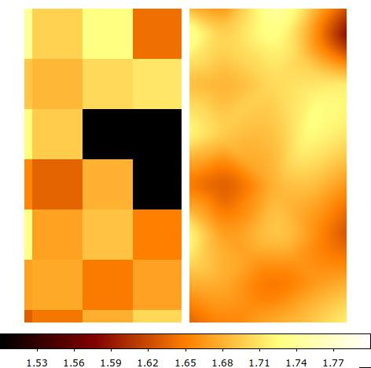

Interpolating solid-waffle outputs
##################################

There are a few ways to take solid-waffle outputs on super-pixels and operate on pixel-level data. There is of course no unique way to do this because no post-processing on super-pixels can create information. But there are a few ways you can operate, depending on precisely what it is that you want to do.

Simple gridding
---------------

The most straightforward way to expand an output to pixel-level resolution is by repetition:

.. code-block:: python

  """Expands the gain from a 32x32 super-pixel file into a 4088x4088 map."""

  import numpy as np

  n = 4096  # what size to expand to
  nx, ny = 32, 32  # number of super-pixels on each axis
  select_col = 5  # which column to take, Python ordered

  data = np.loadtxt("test1_S08__summary.txt")  # example *_summary.txt file
  expand_data_v1 = np.repeat(np.repeat(
      data[:, select_col].reshape((ny, nx)), n//ny, axis=0), n//nx, axis=1
  )

  # if you want to remove reference pixels
  expand_data_v1 = expand_data_v1[4:-4, 4:-4]

This will copy masked super-pixels over to the final output and you should handle them separately, which may be what you want.

Smooth interpolation
--------------------

For some functions, you may want to avoid imposing sharp edges at the super-pixel boundaries. You might also want to interpolate over masked super-pixels; this is likely the case if you want the mask to be at the individual pixel level, but you want to use the quantity for statistical corrections even if that super-pixel has some masked subregions. This is likely the case for BFE kernels, for example.

In that case, you can use solid-waffle's interpolating capability (which currently supports only square super-pixels):

.. code-block:: python

  """Expands the gain from a 32x32 super-pixel file into a 4088x4088 map."""

  import numpy as np

  n = 4096  # what size to expand to
  nx, ny = 32, 32  # number of super-pixels on each axis
  select_col = 5  # which column to take, Python ordered

  data = np.loadtxt("test1_S08__summary.txt")  # example *_summary.txt file

  # more complex version
  from solid_waffle.interpolator import multimedsmooth_expand
  expand_data_v2 = multimedsmooth_expand(data[:, select_col], n=n, ignore=0.0)

  # if you want to remove reference pixels
  expand_data_v2 = expand_data_v2[4:-4, 4:-4]

This uses scipy's ``CloughTocher2DInterpolator`` class (a 2D spline using a Voronoi tessellation constructed from the super-pixels) to interpolate across the super-pixels. It interpolates over masked super-pixels (as identified by either infinite values or the `ignore` keyword). It also puts a ring of points around the SCA at the median level (and a radius equal to twice that of the circumscribing circle) so that the extrapolation at the edge does not product artificial outliers. When interpolating from a square grid, there are two possible Voronoi tessellations; the script averages the two results, so that noise in the super-pixels does not propagate into noise that is correlated upper-left-to-lower-right or upper-right-to-lower-left.

Lower-level control is possible with the ``multimedsmooth`` function.

The two examples can be contrasted in the following gain map for WFI08, in the region ``[1500:2300, 3688:4088]``, where super-pixels (31, 14), (30, 15), and (31, 15) were masked:

- *Left*: Repeating using ``numpy.repeat`` (``expand_data_v1`` in the above case): note the masked pixels are 0's and are off-scale low.

- *Right*: Smooth interpolation (``expand_data_v2`` in the above case): note the 3 masked super-pixels are interpolated over.

